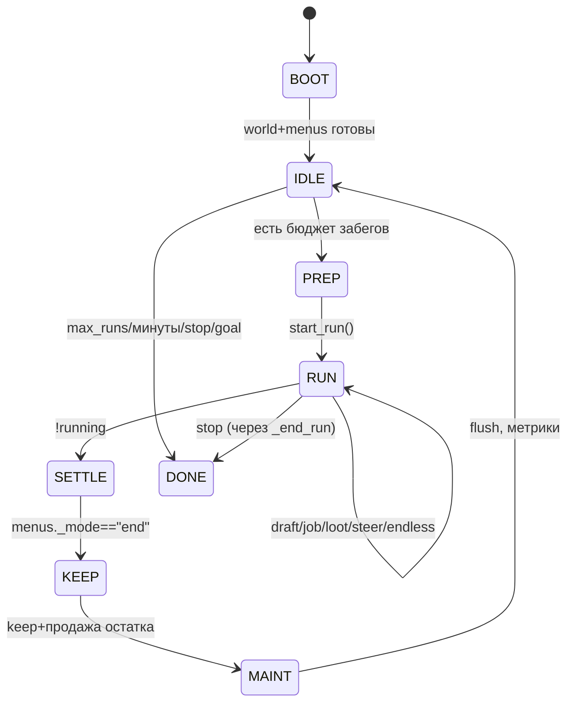

# Farmer v3 — дизайн

Цель: автономный фарм-раннер для **Midgard Survivors 0.2.3**, который часами
играет настоящие одиночные забеги, сам выбирает цель, доводит забег до конца,
безопасно забирает добычу, тратит ресурсы на постоянное усиление и не портит
профиль. Не UI-макрос и не редактор сейва: награды начисляет штатный `_end_run()`.

## 1. Что доказано изучением кода

- Зеньги/опыт/карты/материалы начисляются **во время** забега; классовый опыт и
  продажа сумки — в `_end_run`. Прерванный таймаутом забег всё равно банкуется.
- `hard_loot = danger_reward(d) × featured × frenzy × oath_zeny`; `danger_reward`
  линеен (`1+0.12(d−1)`), а HP мобов растёт как `1.24^d` (+hell). Поэтому
  «максимальная сложность» почти никогда не максимум зеньг/мин; оптимум — там,
  где убийства ещё не упираются в HP. Это надо **измерять**, а не задавать.
- `DANGER_HELL_FROM=16`; обычные Star Crumb падают только с hell≥10 (danger 25+)
  или с MVP (3.5%). Ore: 0.2% с обычного убийства + элиты/боссы/сундуки.
- Стадия важнее danger: у поздних карт плотнее spawn-таблицы и выше `mob_norm`;
  наблюдаемый профиль давал 2.2M зеньг за забег на Thanatos D11 при 80k на
  Prontera D1.
- `menus.auto_pick=true` включает `Bot.pick_choice` (игнорирует `pick_order`) и
  авто-завершение после MVP. Черновик можно вести самим: `offered_choices()` →
  `apply_choice()`.
- `world.autopilot=true` подавляет Hypnotist и Morroc, но включает авто-refine,
  авто-стрелы и не пишет `RunSave`. Движение можно заменить своим `HeroInput`.
- Победа/поражение нигде не сохраняются как флаг забега. Авторитетные признаки:
  `raid.state=="won" && raid.mvp==stage.mvp`, `menus._mode=="victory"`,
  терминальная смерть (`player.fell`, для endless — победа), ожидание
  `menus._mode=="end"` как факт расчёта.
- `Save.add_to_storage` теряет `pot` и делает два flush. Надёжнее один раз
  дописать нормализованную копию в `Save.storage()` и вызвать `mark_dirty/flush`.
- `_sell_left_worn` при выходе с экрана конца: невзятые worn-предметы продаются,
  legendary/unique конвертируются в `legend_coin`. Прямой рестарт это теряет.

## 2. Границы (v1)

Делаем:

- цикл забегов: выбор цели, класса, стадии и danger; бой; draft; job change;
  loot; финальный экран; keep; следующий забег;
- адаптация danger/стадии по измеренной доходности (зеньги, ore, XP, карты,
  питомцы, coins, crumbs);
- партия из конфига (до 2 саппортов), их draft/job/поддержка — легально, через
  тот же draft;
- город без входа в город: апгрейды Kafra/Sage, rebirth, классовые статы,
  достижения, fusion карт, альбом, loadout, питомец, Star Smith (опция),
  очистка склада (опция);
- endless как опция (по времени/MVP), без выхода из арены;
- безопасность: блокировка профиля, бэкапы, атомарный статус, стоп-файл,
  watchdog, макс. забеги/минуты;
- наблюдаемость: `farmer_status.json`, JSONL по забегам, лог, ставки/час.

Не делаем (осознанно, документировано):

- Endless Tower / Hel Tower / Emperium Festival (отдельные режимы, свой UI и
  сохранённые билды; сложность/риск выше пользы для v1);
- Karma-маршруты через портал (нужен выход из арены и выбор; в v1 autopilot
  подавляет Morroc, маршруты не запускаем);
- gacha, town-refine с риском слома, grades, sockets, traits-роллы;
- онлайн-функции, лидерборды, Epic/cloud;
- правка профиля в обход `Save`, любые «grant»-читы.

## 3. Архитектура

Один патч-файл и один драйвер:

```
farmer/
  src/farmer.gd        # весь мозг (Node, PROCESS_MODE_ALWAYS)
  src/save_hook.gd     # bootstrap, добавляется в Save autoload
  tools/inject_hook.py # идемпотентная вставка хука в save.gd
  tools/patch_player.py # next_job: путь профессии из Save meta
  build.sh install.sh run.sh uninstall.sh
  presets/*.json
  README.md
```

Эффективная ФС игры = base → bridge → официальный патч. Наш `patch_farmer.pck`
копирует официальный патч и заменяет `scripts/autoload/save.gdc` (хук) и
`scripts/core/player.gdc` (одна строка в `next_job`), добавляет
`scripts/core/farmer.gdc`. Никаких патчей `bot/altars/auto_pick/debug_menu`.

Почему это работает: `Save` — 4-й автолоад, его дети обрабатываются раньше
главной сцены. Значит драйвер успевает до игрового AI:

| Решение | Механизм |
|---|---|
| draft | `player.offered_choices()` → свой выбор → `apply_choice`; `offer=[]`, `pending_levels-=1` (и для героев пати) |
| job | `Save` meta `farmer_job_paths` + micro-patch `Player.next_job` (штатный UI выбирает случайный путь в том же кадре; polling проигрывает гонку); пати — тот же seam |
| стартовый скилл | `h.set_job_skill(id)` из легальных `job_start_options()` |
| движение | `player.input = FarmerInput.new(brain)` (наследник `HeroInput`); autopilot остаётся включённым для прочих эффектов |
| loot roll | `menus.auto_pick=true` (игра сама зовёт `LootRoll.auto_pick`) |
| keep | прямые `menus._keep_offer` + `_keep_cost`, запись в `Save.storage()` |
| victory/endless | мета `GameData.karma_test` + `menus._mode=="victory"` / `raid.state=="won"` → `continue_endless()` или `_end_run(true)` |
| скорость | `world.speed=3` (frenzy/game_fast) + `world._mvp_slow=true` и `Engine.time_scale` (единый владелец) |

## 4. Состояния



Каждый переход пишет событие в лог; `phase` в статусе — одно из этих имён.

## 5. Политика забега

### 5.1 Выбор цели

`objective` ∈ `zeny | ores | crumbs | xp | cards | pets | coins | progress | balanced`.
Считаем ценность забега:

```
value = zeny
      + w_ore   * (oridecon + elunium + 2*enriched + 4*hd)
      + w_crumb * star_crumb + w_tear * hel_tear
      + w_xp    * class_xp + w_card * cards + w_pet * pets
      + w_coin  * coins + w_ymir * ymir
rate = value / wall_seconds
```

Веса — в конфиге. `progress` максимизирует `max_danger`/новые карты: выбирает
самую высокую доступную опасность и добивает её до победы.

### 5.2 Выбор (stage, danger)

- Кандидаты: открытые и экспортированные стадии; danger в
  `[stage_min .. min(max_danger, danger_ceiling)]`.
- Для `cards/pets`: стадия должна содержать целевого моба; приоритет —
  недостающие карты/питомцы.
- История по «рукам» `(stage, danger)` хранится в статусе: `runs, wins, deaths,
  timeouts, kills/s, value/s, last_value, cooldown`. Выбор: лучшая рука по
  `rate` с ε-исследованием (`explore_every` забегов) соседней руки
  (`danger±1`, новая стадия с целью).
- Победа и `danger < ceiling` → через `win_streak` (2) пробуем `+1`.
- Смерть до `min_run_seconds` или провал по kill-rate → рука в cooldown,
  danger−1; после 2 провалов — соседняя стадия/безопасная рука.
- Жёсткие `stage`/`danger` в конфиге отключают автоподбор (для тестов).
- `featured` (ежедневная карта, +25%) добавляет бонус к score.

### 5.3 Draft

Свой планировщик (не `Bot`/`AutoPick`):

1. `evolve` для выбранной ветки — максимальный приоритет.
2. Скилл из `build.skills` — по индексу.
3. Иначе по типу: AoE/bolt/orbit/ground > damage > shield/heal (при HP<70%)
   > buff/passive > utility; с учётом редкости.
4. Если полезных скиллов нет — стат из `build.stats` (с учётом капов).
5. `potion` — последним.

Применяем циклом до `pending_levels==0` (без UI и без паузы); хомуна кулус
подхватываем как игра (`homun_pick`). Для героев пати — их `build` (саппорт).
`pick_limits`/`run_bans` не используем: не нужны, т.к. выбор делаем сами.

### 5.4 Бой и движение

`FarmerInput.move_vector` → цель в порядке приоритета:

1. `raid.state=="fight"` → `raid.autopilot_goal(hero)` (механики MVP).
2. `menus`/пауза/dawned → 0.
3. Golden Poring жив и в радиусе 40 → его позиция (добить/собрать).
4. Ценный пикап: chest/card/tame/unique < 25, ore < 14, zeny/loot < 10 →
   позиция пикапа (chest имеет приоритет: 5 роллов).
5. Алтарь из `altars.waiting`: `priority` из конфига, дистанция ≤ `altar_range`,
   HP≥70%, не в арене; Hypnotist не трогаем (autopilot его подавляет).
6. `quest.autopilot_goal()` если не INF.
7. Иначе `Bot.steer(self, INF, hero)` — штатное уклонение/сближение.
8. HP<25% и нет пати-хилера → `Bot.steer` к позиции «прочь от ближайшей пачки».

Атаки игра делает сама (`Player.tick`), менять их не нужно.

### 5.5 Loot / keep / neskolko

- `menus.auto_pick=true` → игра сама делает `LootRoll.auto_pick`.
- Keep: считаем ценность `score + pot(120+20*tier+5*lines) + 20*trait + unique`.
  Берём до `KEEP_WIN` (3) бесплатных при победе; при поражении — 1 платный,
  если `keep_on_defeat` и цена ≤ `keep_max_pct` банка. Не берём perm/lent/
  дубликаты unique/мусор без слотов.
- Запись в склад — одной транзакцией:
  `copy={id,slots,extra_slots,refine:0,cards:[],uid,trait?,pot?}` →
  `Save.storage().append(copy)` → `mark_dirty()` → `flush()`.
- Если склад полон: swap только если новый предмет ценнее самого дешёвого
  незащищённого (не loadout, не unique/legend/wings, без pot/trait) на
  `swap_margin`; иначе пропуск + предупреждение.
- После keep — штатная уборка конца забега: для невзятых `_worn` →
  `Equipment.sell_price`, для legendary/unique → `Equipment.cash_in`
  (legend_coin), затем `_keep_offer=[]`, `_keep_pending=false`. Это ровно то,
  что делает `_sell_left_worn`, но без UI.

### 5.6 Endless

`GameData.set_meta("karma_test", true)` (единственный эффект — игра не завершает забег сама после MVP). Пользовательские аргументы `--...` не передаём: `Updater._enabled()` при них отключает все патчи.
При `raid.state=="won"` (наша арена) или `menus._mode=="victory"`:

- если `endless` включён и не исчерпан бюджет (`endless_minutes`,
  `endless_mvps`) → `world.continue_endless()`;
- иначе → `world._end_run(true)`.

Перед продолжением: `world._pull_prizes()`, ждём `_loot==null` и отсутствия
chest/card ≤ 3 с. Смерть в endless игра сама банкует как победу.

### 5.7 Таймауты и watchdog

- `run_minutes` — по `world.time` (игровое время); при превышении —
  `_end_run(false)`, пометка `forced`.
- `arena_wall_max` — по wall-времени: если `raid`/`morroc` держит забег дольше
  N секунд, выходим (для v1 Morroc подавлен, арена MVP ограничена).
- stall: если `world.time` не растёт `stall_seconds` при `running` и не пауза —
  `menus.close()` + `get_tree().paused=false`; повтор → `_end_run(false)`.
- stop-файл: завершить текущий забег штатно (`_end_run(false)`), забрать keep,
  flush, выйти.

## 6. Городская политика (без входа в город)

Порядок maintenance после каждого забега (каждый шаг идемпотентен):

1. `claim_achievement` для всех `unclaimed_achievements`.
2. Апгрейды Kafra: по `upgrade_priority`, пока `zeny − cost ≥ reserve`.
   Без `doom`/`bloody_branch` по умолчанию. `kafra_storage` — до
   `storage_target` (не 48).
3. Sage-апгрейды: `passive_slot → sage_book → sage_root → sage_start →
   fly_wing → magnifier`.
4. Rebirth: `can_rebirth` → `rebirth`; `rebirth_lv_ready` → `take_rebirth_lv`.
5. Class stats: `free_points` → `set_class_stats` по `build.stats`, после
   rebirth.
6. Card fusion: `can_fuse` для карт, у которых copies > `fuse_keep[id]` (по
   умолчанию 0) → `fuse_card`; считаем потраченные копии.
7. Album: `set_equipped_cards` — лучшие owned карты по весам objective
   (`loot/zeny/card/dmg/skill_dmg/crit/hp/move/...`), до `card_slots()`.
8. Loadout: для активного класса заполнить `Save.set_loadout_slot` лучшими
   складскими предметами (score+pot), уважая `loadout_cap`, тип слота, класс.
9. Питомец: `set_active_pet` по `pet_priority`/весам (zeny→golden_bug/poring,
   cards→lunatic, xp→spore, survival→sohee/marina, damage→ork_warrior/isis).
10. Star Smith (опция): выбрать лучший складской предмет с `pot`/подходящим
    слотом; роллить при `star_crumb ≥ potential_reserve + cost`, лочить
    лучшие линии; `hel_tear` — только на semi-perfect legendary линии.
11. Prune (опция): при `storage ≥ cap - reserve` удалить самые дешёвые
    незащищённые предметы без pot/trait; только если это освобождает место.

Всё, что не имеет API без UI, не автоматизируем (см. §2).

## 7. Безопасность

- `run.sh` держит эксклюзивный lock (`flock` на файл в `user://`), проверяет
  процесс игры, делает **уникальный** бэкап `profile.json`, `.bak.json`,
  `.run`; не перезаписывает существующие бэкапы; хранит 10 + один «якорь».
- `build.sh` проверяет SHA официального патча и bridge, пишет
  `patch_farmer.info` (PATCH_FILE/SHA, BYTECODE, BUILT_AT, FARMER_API).
- `run.sh` сверяет `PATCH_SHA256` установленного и собранного патча, версию
  игры и наличие API; при расхождении — отказ, без «попробуем всё равно».
- `save_hook.gd`: только `FARMER_SESSION=1`, только при `farmer.cfg`, только
  headless или `display:true`; битый конфиг → отказ (не дефолты).
- `farmer.gd` пишет статус атомарно (`tmp`→`rename`), лог — append; статус
  содержит `session_id`, `pid`, `phase`, `last_transition`, `heartbeat`.
- Никаких прямых записей в `profile.json`; только `Save`.
- `hard_exit` — опция (SIGKILL после flush) из-за известного teardown-бага;
  по умолчанию включён только в headless и только после `flush` + записи
  статуса `phase=done`.

## 8. Конфиг (v1)

```jsonc
{
  "objective": "balanced",          // zeny|ores|crumbs|xp|cards|pets|coins|progress|balanced
  "weights": {"zeny":1,"ore":2500,"crumb":60000,"tear":200000,"xp":1,"card":50000,"pet":200000,"coin":20000,"ymir":100000},
  "class": "", "classes": [], "class_rotate": false,
  "party": [], "party_builds": {"acolyte":"support_priest","archer":"bard"},
  "stage": "", "stage_pool": [], "danger": "auto", "danger_ceiling": 30,
  "auto_danger": true, "explore_every": 5, "danger_step": 1,
  "featured_bonus": true,
  "speed": 4.0, "game_speed": 3,
  "run_minutes": 12, "arena_wall_max": 180, "stall_seconds": 45,
  "endless": false, "endless_minutes": 4, "endless_mvps": 0,
  "max_runs": 0, "max_minutes": 0, "stop_after_wins": 0,
  "display": false, "offline": true, "hard_exit": true,
  "auto_keep": true, "keep_on_defeat": false, "keep_reserve_slots": 2,
  "keep_max_pct": 0.05, "swap_margin": 1.25,
  "auto_stats": true, "auto_rebirth": false, "auto_rebirth_lv": false,
  "auto_achievements": true,
  "auto_upgrades": true, "upgrade_reserve": 500000, "storage_target": 120,
  "upgrade_priority": ["bubble_gum","battle_manual","greed","blessing","increase_agi","yggdrasil_fruit","fury","gloria","magnificat","angelus","hp_recovery","telescope","kafra_status","kafra_summon","kafra_area","kafra_amount","kafra_blow","vultures_eye","memorize","card_slot","kafra_cart","kafra_storage"],
  "auto_sage": true, "sage_priority": ["passive_slot","sage_book","sage_root","sage_start","fly_wing","magnifier"],
  "auto_cards": true, "auto_fuse": true, "fuse_keep": {},
  "auto_loadout": true, "auto_pet": true, "pet_priority": [],
  "auto_potential": false, "potential_reserve": 20, "potential_max_rolls": 10,
  "auto_storage_prune": false,
  "builds": {
    "thief": {"job_path":0,"skills":["double_attack","enchant_poison","right_hand_mastery","left_hand_mastery","envenom","venom_dust","sonic_blow","edp","meteor_assault","cloaking","improve_dodge"],"stats":["luk","str","agi","vit"]},
    "acolyte": {"job_path":0,"skills":["heal","increase_agi","blessing","sanctuary","assumptio","kyrie_eleison","magnificat"],"stats":["int","vit","dex"]}
  },
  "goals": {"cards":[],"pets":[],"eternal":{},"zeny":0,"materials":{}}
}
```

Поля необязательны; неизвестные игнорируются; неверные типы → отказ старта с
записью причины (не «тихие дефолты»).

## 9. Наблюдаемость

`user://farmer_status.json`:

```jsonc
{
 "session":"20261119-015500-ab12","pid":1234,"phase":"run","heartbeat":1763...,
 "uptime_s":3600,"build":{"patch_sha":"…","game":"0.2.3","api":3},
 "objective":"balanced","target":{"stage":"thanatos","danger":11,"class":"thief","party":[]},
 "totals":{"runs":12,"wins":10,"losses":2,"deaths":2,"timeouts":0,
           "zeny":12345678,"kills":123456,"class_xp":987654,
           "materials":{...},"coins":42,"ymir":3},
 "rates":{"zeny_h":1234567,"kills_min":800,"ore_h":12.3,"crumbs_h":0.4},
 "arms":{"thanatos|11":{"runs":5,"wins":4,"rate":1234.5,"kills_s":33.1}},
 "last":{"run":12,"stage":"thanatos","danger":11,"win":true,"forced":false,
         "wall_s":190.2,"game_s":716.9,"kills":24082,"zeny":2228907,...},
 "maintenance":{"upgrades_bought":["bubble_gum"],"cards_fused":3,...},
 "game":{"running":true,"mode":"fight","time":512.3,"hp":1234,"level":185}
}
```

`user://farmer_runs.jsonl` — по строке на забег (все дельты + выбранная рука).
Лог — `user://farmer.log`, ротация при старте сессии в `.prev`.

## 10. Проверка

1. `build.sh` → pck содержит 2 файла, SHA/bytecode в info.
2. Sandbox: `XDG_DATA_HOME=<копия профиля>` + headless, `max_runs:1`,
   Prontera D1, swordsman → победа, keep, статус `done`, профиль изменился.
3. `max_runs:3` на целевой руке → нет двойного банка, нет потери loot,
   rate считается, stop-файл завершает штатно.
4. Ночной прогон (`max_minutes:120`) → нет утечек/зависаний, статус живой,
   бэкапы не перезаписаны, профиль читается игрой.
5. Отдельно: поражение (danger+10) → defeat, банк частичных наград, danger−1.
6. Отдельно: полный склад → keep делает swap/пропуск, не теряет предметы.

## 11. Риски

- `--endless`/ручное `continue_endless` — не штатный путь UI; при смене патча
  проверить `_victory_when_collected`.
- Draft через `apply_choice` в обход UI дублирует часть `world.choose`; при
  обновлении игры сверить с `player.apply_choice`.
- Star Smith/апгрейды без UI используют внутренние правила; ошибка в стоимости
  может «напечатать» прогресс. Поэтому все траты — через `Save.spend` и точные
  `GameData.*_cost`, с reserve и dry-run логом.
- Высокий danger 26–30: кумулятивные hazard'ы; v1 не гарантирует выживание,
  автоподбор отступит по метрикам.

## 12. Проверка на реальном билде (sandbox, 2026-11-19)

Профиль-копия, `XDG_DATA_HOME` в отдельном каталоге, headless, `FARMER_SESSION=1`,
собранный `patch_farmer.pck` против официального 0.2.3.

| Сценарий | Результат |
|---|---|
| один забег Swordsman/Prontera/D1 | победа; 2 358 убийств, 58 704 зеньги, 13 001 XP, 1 Ymir, 2 карты, 8 elu + 10 ori; keep 3 предмета; `phase=done` |
| endless 1 мин / 2 MVP | первый MVP → `continue_endless`, второй MVP → `ENDLESS_DONE`, победа, keep 3; без ложных срабатываний `raid.state` |
| party Thief + Acolyte + Archer/D6 | `job=assassin_cross`, пати `high_priest` (путь 0) и `bard` (путь 1), 8/9 скиллов, 5 995 убийств за 300 game-sec, без смертей |
| maintenance на endgame-профиле | апгрейд Kafra, Sage, fuse +43, альбом 4 карты, loadout 4 слота, питомец, 3 ролла Potential; награды забега считаются до трат |
| stop по `max_minutes` | STOP → `_end_run(false)` → settle/keep → FINISH; частичные награды забанкованы, `run.sh` вернул 0 |
| install/uninstall | state.json переключается на `patch_farmer.pck` и обратно; SHA проверяются; профиль/логи сохраняются |
| `-- --endless` | **не использовать**: Updater видит `--...` и не монтирует патчи; endless включается метой `karma_test` |

Все прогоны — на копии профиля; основной профиль не изменялся.
