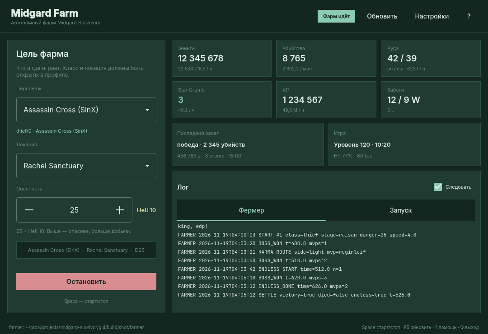

# Midgard Farm



A small Qt Quick control panel for the Midgard Survivors farmer. Pick a
character and a staging ground, set the danger, start the farm, and watch the
same `farmer_status.json` and `farmer.log` the CLI uses. The farmer keeps
running when the window is open; stopping writes the same `farmer_stop` file.

## Build and run

```bash
./bin/build
./build/midgardfarm
```

The app follows the live Omarchy accent, background and text colours, and
Hyprland's effective window rounding. It finds the farmer at
`../farmer` from the build directory; if you move it, open **Настройки** and
point it at the directory containing `tools/farm.py` and `targets.json`.

Install it into the launcher:

```bash
./bin/install
```

## What it does

- `targets.json` supplies 23 stage ids and named characters (SinX, Sniper,
  Bard, Knight, …).
- Starting runs `python3 tools/farm.py --char … --stage … --danger …`; the
  farmer reads the selected class's profile `pick_order`/`pick_limits`.
- The farmer checks the choice against the live game. An unavailable location,
  out-of-range difficulty or invalid oath fails the session with
  `invalid_location`, `invalid_difficulty` or `invalid_oath`, respectively.
  A locked character is not replaced with another one.
- Status cards show zeny, kills, oridecon/elunium, Star Crumb, XP and runs;
  the log has separate **Фермер** and **Запуск** tabs.
- AFK: a run ends by death or the 42 game-minute cap, banks its loot and the
  next one starts. The app stays a controller, not a save editor.

## Shortcuts

| Key | Action |
|---|---|
| Space | start / stop |
| F5 | refresh status |
| ? | help |
| Q | quit (asks to stop a running farm) |
| Esc | close help |

## Tests

```bash
./bin/test
```

The tests cover target parsing and preferred order, status/log parsing,
notice detection, theme fallback/colours and the Hyprland rounding watcher.

## Farmer

The backend is the `farmer/` directory in this repository. The pack must be
built and installed there; the GUI only launches `tools/farm.py`. See
`../farmer/README.md`.
